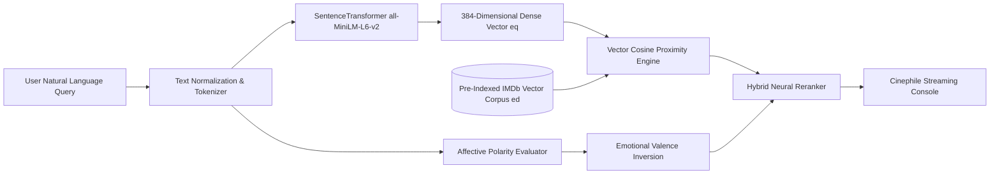

<div align="center">
  

  <br/><br/>

  [](https://www.python.org/)
  [](https://pytorch.org/)
  [](https://huggingface.co/sentence-transformers/all-MiniLM-L6-v2)
  [](https://opensource.org/licenses/MIT)

  <br/>

  <a href="https://yasmenmad.github.io/chatbot/"><strong>Verified Live Deployment</strong></a> &middot;
  <a href="https://github.com/yasmenmad/chatbot"><strong>GitHub Source</strong></a>
</div>

---

## Overview

**Filmo** is a neural semantic vector retrieval engine and cinema intelligence platform. Built on top of **PyTorch** and HuggingFace's **`all-MiniLM-L6-v2`** SentenceTransformer, the system indexes curated IMDb film corpora into dense 384-dimensional latent embedding spaces.

Beyond conventional keyword matching, Filmo evaluates query intent through dense continuous manifolds and features **Affective Valence Inversion** &mdash; proactively analyzing emotional cadence to surface heartwarming cinema when user sentiment indicates fatigue or low mood.

---

## Algorithmic Formulation

### 1. Dense Semantic Representation

User query $q$ and catalog synopsis documents $d \in \mathcal{D}$ are projected into a continuous 384-dimensional manifold:

$$\mathbf{e}_q = f_\theta(q), \quad \mathbf{e}_d = f_\theta(d), \quad \mathbf{e} \in \mathbb{R}^{384}$$

Semantic alignment is computed through cosine distance over normalized embeddings:

$$\text{sim}_{\text{dense}}(q, d) = \frac{\mathbf{e}_q \cdot \mathbf{e}_d}{\|\mathbf{e}_q\|_2 \|\mathbf{e}_d\|_2}$$

### 2. Affective State Modulation & Valence Inversion

Filmo computes user query valence $V(q) \in [-1.0, 1.0]$. When negative sentiment or psychological exhaustion is detected ($V(q) < -0.30$), the system executes valence inversion:

$$\text{Score}_{\text{final}}(q, d) = \alpha \cdot \text{sim}_{\text{dense}}(q, d) + \beta \cdot \max(0, V(d))$$

Where $\beta$ proactively upweights uplifting, heartwarming narratives to alleviate negative affect.

---

## Architecture Flow



---

## Installation & Local Execution

```bash
# Clone the repository
git clone https://github.com/yasmenmad/chatbot.git
cd chatbot

# Install Python dependencies
pip install -r requirements.txt

# Run Python inference server or launch the local client
python -m http.server 8000
```

Access the neural cinema portal at `http://localhost:8000` or experience the live deployment at [yasmenmad.github.io/chatbot/](https://yasmenmad.github.io/chatbot/).

---

## Author

- **Researcher & Engineer:** Yasmine Daoudi
- **Focus:** Natural Language Processing, Dense Vector Retrieval & Deep Learning
- **Contact:** [yasmineedaoudii@gmail.com](mailto:yasmineedaoudii@gmail.com) &middot; [LinkedIn](https://www.linkedin.com/in/yasmine-daoudi-eng)
